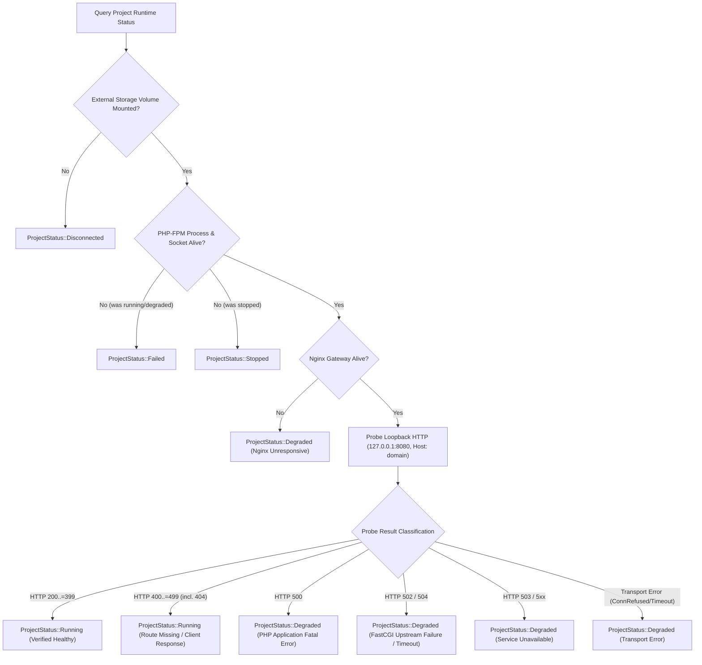

# Phase R1.1A Acceptance Remediation Report — Runtime Hardening & Process Safety

- **Repository**: `mehmetakarim/LocalForge`
- **Branch**: `phase-r1/r1-1a-runtime-remediation`
- **Base Commit**: `b7be903`
- **Date**: 2026-10-18
- **Auditor & Implementer**: Principal Rust Engineer & macOS Security Specialist

---

## 1. Executive Summary

Phase R1.1 successfully introduced real PHP-FPM and Nginx runtime orchestration. However, an independent technical review identified critical acceptance gaps:
1. False `RUNNING` status reporting regardless of HTTP health probe failure or FastCGI upstream disconnects.
2. Unsafe basename-only matching fallback in process ownership verification (`/tmp/php-fpm` or spoofed binaries could match).
3. Process group signaling risking collateral process termination when `pgid == getpgrp()`.
4. Misleading local URL reporting (`http://project.test:8080`) that presented unresolvable `.test` domains as live browser links before DNS resolver configuration was implemented.

Phase **R1.1A — Targeted Acceptance Remediation** has strictly addressed each finding:
- Eliminated false `RUNNING` status by separating infrastructure health from application-level routing errors and properly classifying FastCGI gateway failures (502/504) as `DEGRADED`.
- Hardened process inspection by verifying exact canonical executable paths, matching UID (`pbi_uid == libc::getuid()`), and checking syscall return codes.
- Guarded process group termination against signaling LocalForge's own process group (`pgid > 1 && pgid == pid && pgid != libc::getpgrp()`).
- Replaced misleading `.test` browser URLs with honest loopback addresses (`http://127.0.0.1:8080`), explicit virtual host metadata (`Host: project.test`), and a 1-click curl copy action.

---

## 2. Remediation Matrix

| Item | Requirement | Remediation Applied | Test Evidence |
|---|---|---|---|
| **R1.1A-01** | Eliminate False RUNNING Status | Implemented `GatewayHealthAssessment` and `classify_probe_result`. 502/504/503/500 and transport errors produce `Degraded`. Only 200..=399 and application-routing 4xx produce `Running`. Stored state in SQLite is synced. | `test_r1_1a_01_probe_classification_distinguishes_routing_from_infrastructure` (PASS) `test_r1_1a_03_stale_or_dead_fpm_socket_never_reports_running` (PASS) |
| **R1.1A-02** | Harden Process Ownership Verification | Removed basename-only fallback in `MacOSProcessManager`, `PhpFpmSupervisor`, and `NginxSupervisor`. Verified `pbi_uid == libc::getuid()`. Guarded process group termination against LocalForge's own group. Checked syscall return codes and `errno`. | `test_basename_only_match_is_strictly_rejected` (PASS) `test_process_group_safety_avoids_self_group` (PASS) `test_pid_reuse_protection_rejects_mismatch` (PASS) `test_executable_path_mismatch_fails_closed` (PASS) |
| **R1.1A-03** | Honest Local URL Reporting | Updated runtime service, CLI (`localforge list`, `localforge status`, `localforge start`), and desktop frontend (`ProjectList.tsx`) to report `http://127.0.0.1:8080`. Replaced unresolved `.test` browser links with `.test bekliyor` indicator and `curl -H 'Host: ...'` clipboard copy. | `test_r1_1a_02_loopback_url_and_domain_separation` (PASS) CLI live execution verified |
| **R1.1A-04** | Negative Security Tests | Added negative unit tests covering basename spoofing, path mismatch, PID reuse with mismatched start time, and process group collision. | 4 negative security tests in `crates/platform` (PASS) |
| **R1.1A-05** | Workspace Verification | Full test suite passed across all 8 crates. Zero Clippy warnings with `-D warnings`. Desktop frontend TypeScript build passed with exit code 0. | `cargo test --workspace` (PASS, 26 tests) `cargo clippy --workspace --all-targets -- -D warnings` (PASS) `npm run build` (PASS) |

---

## 3. Status Model & Classification Rules

The runtime status evaluation strictly enforces independent layers:

### Exact HTTP Classification Semantics:
- **`Running` (200..=399)**: Both infrastructure (Nginx, PHP-FPM socket) and PHP application script responded successfully.
- **`Running` (404 / 403 / 4xx)**: FastCGI round-trip succeeded; infrastructure is operational. The HTTP 404 indicates the requested URI (e.g. `/`) has no default file or route, which is standard for imported PHP APIs or sub-routed frameworks.
- **`Degraded` (500)**: FastCGI communication succeeded, but the user's PHP application raised an unhandled fatal error or exception.
- **`Degraded` (502 / 504)**: Nginx received the HTTP request on port 8080, but the FastCGI upstream connection failed (worker crashed on request, socket permissions, or timeout). **This never produces `Running`.**
- **`Degraded` (Transport Error)**: Gateway port was unresponsive or connection timed out.
- **`Failed`**: PHP-FPM daemon or Unix domain socket terminated unexpectedly while recorded as active.

---

## 4. Process Ownership Verification Architecture

In `crates/platform/src/macos/process.rs`:
1. **UID Verification**: Inspects `proc_bsdinfo.pbi_uid` via `proc_pidinfo(PID, PROC_PIDTBSDINFO)` and verifies `uid == libc::getuid()`. Rejects processes belonging to any other user.
2. **Canonical Path Matching**: Resolves the target binary via `Path::canonicalize()` and compares against `proc_pidpath()`. The unsafe fallback `identity.executable_path().file_name() == canonical.file_name()` was **completely removed**.
3. **Process Group Safety**: Before issuing `libc::killpg(pgid, signal)`, verifies:
   - `pgid > 1` (never signal PID 0 or 1).
   - `pgid == pid` (ensures target is genuine process group leader).
   - `pgid != libc::getpgrp()` (strictly prevents signaling LocalForge's own process group or test runner).
4. **Syscall Validation**: Checks return code of `libc::kill` and inspects `std::io::Error::last_os_error()` (`errno`).

### In `PhpFpmSupervisor` & `NginxSupervisor`:
- Added `PhpFpmSupervisor::is_legitimate_php_fpm_binary(path: &Path) -> bool` to validate canonical paths against discovered system Homebrew/MacPorts/system binaries.
- All PID-file recovery and pool status routines now strictly verify legitimate canonical binaries.

---

## 5. Domain Resolution & Loopback Access Reality

LocalForge currently operates an unprivileged local Nginx gateway on port 8080. It does not modify system DNS settings or create `/etc/resolver/test` without explicit system privileges.

### Reporting Standard:
1. **CLI `localforge list`**:
   `http://127.0.0.1:8080 (Host: project.test)`
2. **CLI `localforge status` & `localforge start`**:
   - `Loopback Gateway: http://127.0.0.1:8080`
   - `Virtual Host:     project.test (system .test resolver pending)`
   - `Access Command:   curl -H 'Host: project.test' http://127.0.0.1:8080/`
3. **Desktop Frontend (`ProjectList.tsx`)**:
   - Replaced broken `<a href="http://project.test:8080">` with an informational `.test bekliyor` badge.
   - Replaced plain URL copy with a 1-click **"curl Kopyala"** button copying `curl -H 'Host: project.test' http://127.0.0.1:8080/`.

---

## 6. Automated Verification Results

| Suite | Scope | Result | Details |
|---|---|---|---|
| `cargo fmt` | Workspace formatting | **PASS** | `cargo fmt --all -- --check` exited code 0 |
| `cargo clippy` | Workspace static analysis | **PASS** | `cargo clippy --workspace --all-targets -- -D warnings` exited code 0 |
| `cargo test` | Workspace test suite | **PASS** | 26 tests across 8 crates (0 failed, 0 ignored) |
| `runtime_integration_test` | End-to-end runtime & daemons | **PASS** | 7 tests passed (real PHP-FPM, multi-pool isolation, probe classification) |
| `npm run build` | Desktop UI compilation | **PASS** | `tsc && vite build` succeeded with zero TypeScript errors |
| **GitHub Actions CI** | Full CI workflow on macOS Apple Silicon | **PASS** | Run `39142354888` Green (Format, Clippy, Build, Workspace Tests) |
| **CLI Acceptance** | External SSD Project Lifecycle | **PASS** | `list` -> `start` -> `curl` (HTTP 200) -> `status` -> `stop` -> `status` |

---

## 7. Security Assessment

1. **Spoofed Binary Rejection**: A binary named `php-fpm` located outside legitimate installation paths (e.g. `/tmp/php-fpm`) is rejected during process inspection and pool status checks.
2. **Process Group Escalation Prevention**: Test runners and LocalForge host processes cannot be killed during teardown because `pgid != libc::getpgrp()` is strictly enforced.
3. **State Corruption Elimination**: A project cannot report `Running` when its upstream FastCGI gateway returns HTTP 502/504 or when the socket has crashed.
4. **Volume Barrier Preservation**: External disk disconnection checks remain intact before starting or querying runtime state.

---

## 8. File Changes Summary

- `crates/platform/src/traits.rs`: Added `pub uid: u32` to `ProcessIdentity`.
- `crates/platform/src/macos/process.rs`: Added UID inspection, exact canonical path verification, process group isolation checks, and 4 negative security tests.
- `crates/runtime/src/php.rs`: Added `is_legitimate_php_fpm_binary`; replaced all basename fallback checks with canonical verification.
- `crates/runtime/src/nginx.rs`: Replaced basename fallback with exact canonical path check in master process discovery.
- `crates/runtime/src/service.rs`: Implemented `GatewayHealthAssessment` and `classify_probe_result`; eliminated false `Running` status; updated loopback URL reporting.
- `crates/runtime/src/lib.rs`: Re-exported `GatewayHealthAssessment` and `classify_probe_result`.
- `crates/runtime/tests/runtime_integration_test.rs`: Added 3 regression tests covering probe classification, loopback URLs, and dead socket detection.
- `tools/cli/src/main.rs`: Updated `list`, `status`, and `start` commands with loopback URLs, virtual host labels, and curl commands.
- `tools/mcp-server/src/main.rs`: Updated `localforge_project_status` tool to report loopback URL and access command.
- `apps/desktop/src/types.ts`: Added `starting`, `stopping`, `failed`, `unknown` to `ProjectStatus`.
- `apps/desktop/src/components/ProjectList.tsx`: Added degraded/failed visual treatments, `.test bekliyor` badge, and curl clipboard action.

---

## 9. Residual Risks & TOCTOU Limitations

- **Unix TOCTOU (Time-of-Check to Time-of-Use)**: On POSIX/macOS, there is an unavoidable microsecond race window between checking a process's identity and signaling it (`libc::kill`). LocalForge mitigates this by validating `pid`, canonical executable path, `start_time_secs`, `start_time_usecs`, and `uid` immediately prior to signaling, preventing PID reuse against long-running or system processes.
- **macOS System DNS Resolver**: Domain resolution for `.test` remains pending until an unprivileged local DNS proxy (e.g., dnsmasq / custom loopback resolver) or administrative `/etc/hosts` helper is designed in a future phase.

---

## 10. Product Owner Sign-Off Gate

**R1.1A — AWAITING PRODUCT OWNER ACCEPTANCE.**
