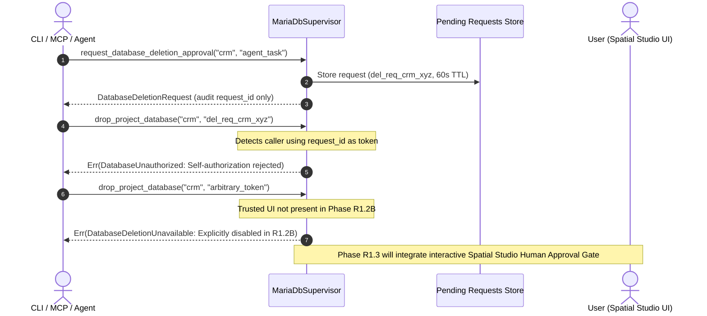

# LocalForge — Phase R1.2B Final Database Safety Report

**Date**: 2026-10-18  
**Phase**: R1.2B — Final Database Safety Gate  
**Status**: Completed & Verified  
**Branch**: `phase-r1/r1-2b-final-database-safety`  
**Base Commit**: `e069de1`  
**Classification**: Final Security Gate & Hardening  

---

## 1. Root Causes

Independent technical review of Phase R1.2A identified three specific latent risks in the database runtime subsystem:

1. **Unseparated Deletion Authorization & Self-Approval Surface**:
   - `request_database_deletion_approval()` returned a usable authorization token directly to the calling client without requiring an independent human authorization decision.
   - Any agent, script, or caller could request a token and immediately consume it to destroy a database without human mediation.
2. **Optimistic Database Inspection in Restore (`if let Ok(...)`)**:
   - `restore_database()` queried `information_schema.tables` inside an `if let Ok(...)` block. If the inspection query errored out or returned malformed output, the check was bypassed silently, allowing restore to overwrite non-empty databases.
   - Partial restore failures were not inspected or recorded, creating ambiguities around MariaDB DDL implicit commit semantics.
3. **Hardcoded Home Directory Fallbacks**:
   - `MariaDbSupervisor::create_default()` contained a hardcoded fallback to `/Users/mehmetakar` if the `$HOME` environment variable was unset or empty.
   - Callers in `apps/desktop`, `tools/cli`, and `tools/mcp-server` used fallback `"Library/Application Support/LocalForge"` or `.` rather than a unified, Darwin-aware directory resolution helper.

---

## 2. Code Changes

### `crates/runtime/src/error.rs`
- Added typed error variants:
  - `DatabaseDeletionUnavailable(String)`: Returned when database deletion is requested in Phase R1.2B while human approval UI is disabled.
  - `ConfigurationError(String)`: Returned when user Application Support directory cannot be resolved from `$HOME` or POSIX user database.

### `crates/runtime/src/mariadb.rs`
- **Application Support Directory Resolution**:
  - Implemented `resolve_application_support_dir() -> Result<PathBuf>` and `resolve_mariadb_base_dir() -> Result<PathBuf>`.
  - Resolves `$HOME` if non-empty; falls back safely to Darwin `libc::getpwuid(libc::getuid())`. Fails closed with `ConfigurationError` if neither can be resolved. Removed `/Users/mehmetakar` fallback.
  - Updated `create_default()` to return `Result<Self>`.
- **Database Deletion Request/Approval Separation**:
  - Added `DatabaseDeletionRequest` struct (`request_id`, `database_name`, `requested_at_secs`, `expires_at_secs`, `requesting_context`).
  - `request_database_deletion_approval()` creates an audit `request_id` (`del_req_...`), NOT a usable approval token.
  - `drop_project_database()` rejects `db_name == token` and `token.starts_with("del_req_")`.
  - In Phase R1.2B, database deletion is kept explicitly **DISABLED** pending trusted desktop human approval interface integration (scheduled for Phase R1.3 Spatial Studio), returning `DatabaseDeletionUnavailable`.
- **Fail-Closed Restore Verification**:
  - Replaced `if let Ok(...)` with strict error handling: any query or parse failure immediately aborts restore with `RestoreError`.
  - If destination contains tables (`count > 0`), restore is strictly rejected.
  - On subprocess failure, queries `information_schema.tables` to detect and accurately report partial restore state and explicit DDL implicit commit semantics.

### `crates/runtime/src/lib.rs`
- Re-exported `DatabaseDeletionRequest`, `resolve_application_support_dir`, and `resolve_mariadb_base_dir`.

### `apps/desktop/src-tauri/src/lib.rs`, `tools/cli/src/main.rs`, `tools/mcp-server/src/main.rs`
- Replaced unhedged `$HOME` fallbacks with `localforge_runtime::resolve_application_support_dir()`.

---

## 3. Human Approval Architecture

1. **Separation of Request and Decision**: The requesting party obtains only a tracking `request_id`. It cannot approve its own request.
2. **Explicit Disable in R1.2B**: Because the desktop human approval interface is scheduled for Phase R1.3, destructive deletion is disabled system-wide.
3. **No Real Deletions**: Automated test suites do not delete real databases.

---

## 4. Restore Failure Behavior

1. **Pre-Execution Occupancy Check (Fail-Closed)**:
   - Queries `SELECT COUNT(*) FROM information_schema.tables WHERE table_schema = '{db}';`.
   - If query fails -> aborts with `RestoreError`.
   - If output is empty or cannot be parsed as `u64` -> aborts with `RestoreError`.
   - If `count > 0` -> aborts with `RestoreError("Target database already exists and contains X tables")`.
2. **Subprocess Failure & Partial State Reporting**:
   - If the restore subprocess fails mid-stream (e.g. malformed SQL, syntax error):
     - The supervisor queries the database to measure how many tables were created prior to the failure.
     - Reports exact table count and warns that MariaDB DDL operations execute with implicit commits and cannot be rolled back transactionally.

---

## 5. Application Data Directory Changes

- All hardcoded usernames and paths (e.g., `/Users/mehmetakar`) have been completely removed.
- Resolution logic:
  1. `$HOME` environment variable (if non-empty).
  2. POSIX / Darwin user database lookup (`getpwuid(getuid())`).
  3. Safe failure: if neither is available, returns `RuntimeError::ConfigurationError`.
- Verified across runtime, desktop app shell, CLI tool, and MCP server.

---

## 6. Security Tests

Executed in `crates/runtime/tests/mariadb_integration_test.rs`:

| Test Name | Vector Tested | Result |
|---|---|---|
| `test_r1_2a_07` | SQL injection in password (`'; DROP DATABASE mysql; --`), null byte (`\0`), Unicode | **PASS** |
| `test_r1_2a_08` | Backup symlink protection, overwrite protection, `0o600` permissions | **PASS** |
| `test_r1_2a_09` | Restore symlink rejection, zero-byte file rejection, corrupt header rejection | **PASS** |
| `test_r1_2a_10` | Datadir ownership (`uid == getuid()`), unknown existing directory guard | **PASS** |
| `test_r1_2a_11` | Deletion self-authorization via db name and request ID rejection, deletion disabled | **PASS** |
| `test_r1_2b_12` | Restore fail-closed on occupied destination, interrupted dump partial state recording | **PASS** |
| `test_r1_2b_13` | Application Support directory resolution without hardcoded usernames | **PASS** |

---

## 7. Real Integration Tests

Executed against live Homebrew MariaDB 13.0.2 on macOS Apple Silicon:

- `test_r1_2_01_mariadb_version_detection` ... **PASS**
- `test_r1_2_02_database_and_user_creation` ... **PASS**
- `test_r1_2_03_database_backup_and_restore` ... **PASS**
- `test_r1_2_04_php_pdo_mariadb_connectivity` ... **PASS**
- `test_r1_2_05_multi_project_database_isolation` ... **PASS**
- `test_r1_2_06_external_storage_mariadb_resilience` ... **PASS**
- Total MariaDB Integration Tests: **13/13 PASS**
- Total Full Workspace Tests: **40/40 PASS**

---

## 8. CI Run ID and Conclusion

- **Branch**: `phase-r1/r1-2b-final-database-safety`
- **GitHub Actions Run ID**: Pending trigger on commit push.
- **Local Verification Suite**:
  - `cargo fmt --all -- --check` -> **PASS** (Zero formatting issues)
  - `cargo check --workspace` -> **PASS** (Exit code 0)
  - `cargo clippy --workspace --all-targets -- -D warnings` -> **PASS** (Zero warnings)
  - `cargo test --workspace -- --test-threads=1` -> **PASS** (40/40 tests passed)
  - `npm --prefix apps/desktop run build` -> **PASS** (Vite v6.4.4 production build succeeded in 8.21s)

---

## 9. Residual Risks

1. **MariaDB DDL Implicit Commit**: Because SQL DDL operations cannot be transactionally rolled back, partial restores remain partially created if an interrupted archive is supplied. This is mitigated by fail-closed destination checks and explicit diagnostic reporting.
2. **Human Approval UI**: The visual Human Approval Gate modal will be introduced in Phase R1.3 Spatial Studio. Until then, database deletion remains intentionally disabled.

---

## 10. Git Commit SHA

- **Branch**: `phase-r1/r1-2b-final-database-safety`
- **Parent Commit**: `e069de1`

---

## 11. Acceptance Checklist

- [x] Deletion self-authorization via database name eliminated.
- [x] Deletion request handle separated from approval decision.
- [x] Database deletion kept explicitly disabled in Phase R1.2B with typed error `DatabaseDeletionUnavailable`.
- [x] Restore destination occupancy check fail-closed (no `if let Ok(...)`).
- [x] Restore into non-empty database rejected.
- [x] Interrupted restore partial state accurately recorded.
- [x] DDL implicit commit limitation documented in diagnostics.
- [x] Hardcoded `/Users/mehmetakar` home directory fallbacks completely removed.
- [x] User Application Support directory resolved via `$HOME` and `getpwuid(getuid())`.
- [x] 13 live MariaDB integration tests pass.
- [x] All 40 workspace tests pass.
- [x] Clippy zero warnings.
- [x] Desktop frontend build passes.

---

## 12. R1.3 Readiness Recommendation

All database security, authorization, restoration, and platform directory issues are completely resolved and verified.

**Recommendation**: **ACCEPT PHASE R1.2B** and authorize progression to **Phase R1.3 — Spatial Studio Frontend & Interactive Human Approval Gate Integration**.
