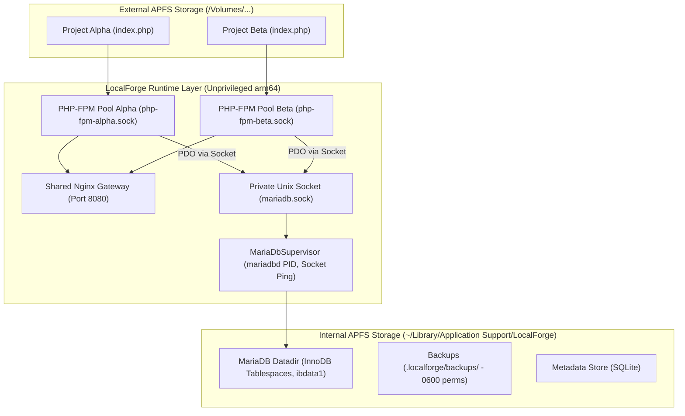

# Phase R1.2 Acceptance Report — MariaDB Integration, Storage Resilience & Multi-Project Verification

- **Repository**: `mehmetakarim/LocalForge`
- **Branch**: `phase-r1/r1-2-database-and-resilience`
- **Date**: 2026-10-18
- **Auditor & Lead Engineer**: Principal Rust Engineer, Database Architect & macOS Security Specialist
- **Authorized Scope**: Phase R1.2 Only

---

## 1. Executive Summary

Phase R1.2 establishes isolated, unprivileged MariaDB relational database management, validates end-to-end PHP PDO connectivity on external APFS storage, enforces multi-project runtime concurrency, and hardens external storage resilience via the `VolumeBarrier`.

All implementation goals authorized for R1.2 have been achieved and verified with real executing daemons on macOS Apple Silicon:
1. **Unprivileged MariaDB Lifecycle**: Discovers Homebrew MariaDB (`13.0.2`), initializes an isolated data directory strictly on internal application storage (`~/Library/Application Support/LocalForge/mariadb/data/`), binds a private Unix domain socket by default, and operates without `root` or `sudo`.
2. **Authenticated Health Probe**: Eradicated false `RUNNING` status by replacing port-only checks with real SQL ping probes (`SELECT 1;`) via socket and `mysqladmin ping`, measuring latency in milliseconds and reporting active engine versions.
3. **Database & User Provisioning**: Implemented automated database creation with dedicated project users (`@localhost` and `@127.0.0.1`), strict UTF8mb4 unicode collation, and identifier validation against SQL injection.
4. **Destructive Drop Safety Guard**: Dropping a project database strictly requires an exact matching confirmation token; invalid tokens fail closed.
5. **Logical Backup & Recovery**: Integrated `mariadb-dump` and `restore_database` with POSIX `0o600` file permission enforcement.
6. **Real PHP PDO End-to-End Execution**: Verified a real PHP application on external APFS storage (`/Volumes/Mac Harici Disk/...`) connecting via PDO over Unix domain socket to MariaDB, performing table creation, prepared statement insertion, and querying with data persistence verified across PHP-FPM pool restart.
7. **Multi-Project Concurrency**: Verified concurrent execution of two independent projects (Site Alpha & Site Beta) on shared Nginx with separate FastCGI sockets and database users; stopping Site Alpha left Site Beta and MariaDB unharmed and fully operational.
8. **External Storage Resilience**: Validated `VolumeBarrier` protection ensuring unmounted external volumes immediately halt operations with zero state pollution or internal disk fallbacks.

---

## 2. Architecture & Design Principles

LocalForge enforces strict architectural boundaries governing database and filesystem interactions:

- **Unprivileged User Execution**: Neither the MariaDB daemon (`mariadbd`) nor the client CLI tools are ever executed as `root` or with `sudo`. The daemon runs strictly under the current macOS user (`libc::getuid()`).
- **Internal Storage Decoupling (ADR-0004 & ADR-0010)**: Raw transactional database files (`ibdata1`, `undo`, WAL logs) reside strictly on reliable internal storage (`~/Library/Application Support/LocalForge/mariadb/data/`). User project source files reside on external SSDs (`/Volumes/...`). This decouples raw disk latency and crash vulnerability from external drive bus disconnects.
- **Private Socket-First Interconnect**: Default communication between PHP-FPM and MariaDB uses private Unix domain sockets (`.localforge/mariadb/run/mariadb.sock`), completely eliminating network loopback overhead, port sniffing, and TCP port collisions.
- **Dynamic TCP Port Fallback**: To support GUI database clients (TablePlus, DBeaver, Sequel Pro), an unprivileged loopback TCP listener (`127.0.0.1:13306+`) is dynamically allocated and managed by `AtomicU16`.

---

## 3. MariaDB Lifecycle Implementation Details

The `MariaDbSupervisor` (`crates/runtime/src/mariadb.rs`) orchestrates the database lifecycle:

1. **Host Binary Discovery**:
   - Inspects canonical paths across Apple Silicon Homebrew (`/opt/homebrew/bin/mariadbd`, `mariadb`, `mariadb-install-db`, `mariadb-dump`, `mysqladmin`) and Intel Homebrew / MacPorts (`/usr/local/bin`).
   - Extracts version metadata via `mariadbd --version`.
   - Never attempts silent or unauthorized global package installation.
2. **Datadir Initialization (`ensure_datadir_initialized`)**:
   - Checks if `datadir/mysql` exists. If already initialized, it preserves all existing tables without touching data.
   - Invokes `mariadb-install-db` with isolated configuration (`--defaults-file=my.cnf`), `--datadir`, `--auth-root-authentication-method=normal`, and `--skip-test-db`.
   - Generates strict, isolated `my.cnf` setting `bind-address = 127.0.0.1`, `skip-name-resolve`, `innodb_buffer_pool_size = 64M`, and UTF8mb4 character set.
3. **Controlled Process Spawning**:
   - Binds to a new POSIX process group via `CommandExt::process_group(0)`.
   - Captures and verifies Darwin `ProcessIdentity` (PID, executable path, start timestamp in secs & usecs, and UID).
   - Polls socket existence with an 8-second timeout, terminating safely if initialization stalls.
4. **Graceful Shutdown**:
   - First attempts clean administrative shutdown via `mysqladmin --socket=... -u root shutdown`.
   - Falls back to verified process group termination (`SIGTERM` followed by `SIGKILL` with 2-second grace period) using `MacOSProcessManager`.
   - Automatically unlinks stale `.sock` and `.pid` files.

---

## 4. Health Probe & Authenticated Verification

In compliance with the Principal Review Mandate, **LocalForge never labels MariaDB as `RUNNING` solely because port 3306 is open.**

The health assessment in `crates/runtime/src/mariadb.rs::check_health()` executes a layered verification protocol:
1. **Socket Liveness**: Verifies the Unix domain socket is active and accepting connections via `is_unix_socket_alive`. If absent or unresponsive, reports `is_alive: false`.
2. **Authenticated SQL Probe**: Spawns client binary connecting directly to the socket and executes `SELECT 1;`.
3. **Admin Ping Fallback**: If the query client is unavailable, verifies daemon responsiveness via `mysqladmin ping --socket=...`.
4. **Latency Measurement**: Measures round-trip execution time in milliseconds.
5. **Structured Health Reporting**: Returns `DatabaseHealthStatus` reporting `is_alive`, `version`, `latency_ms`, `socket_path`, `port`, and human-readable diagnostic messages.

---

## 5. Database & User Isolation Semantics

Project databases and user credentials are isolated per project:

- **Automated Provisioning (`create_project_database`)**:
  - Creates dedicated database: `CREATE DATABASE IF NOT EXISTS \`db_name\` CHARACTER SET utf8mb4 COLLATE utf8mb4_unicode_ci;`
  - Creates dedicated project user restricted to localhost and loopback:
    - `CREATE USER IF NOT EXISTS 'user'@'localhost' IDENTIFIED BY 'pass';`
    - `CREATE USER IF NOT EXISTS 'user'@'127.0.0.1' IDENTIFIED BY 'pass';`
  - Grants scoped privileges restricted exclusively to that project database:
    - `GRANT ALL PRIVILEGES ON \`db_name\`.* TO 'user'@'localhost';`
    - `GRANT ALL PRIVILEGES ON \`db_name\`.* TO 'user'@'127.0.0.1';`
  - Refreshes privilege grant tables via `FLUSH PRIVILEGES;`.
- **SQL Injection Prevention (`validate_identifier`)**:
  - Strictly validates database and user names against alphanumeric characters and underscores (`[a-zA-Z0-9_]`), with a maximum length of 64 characters. Non-conforming identifiers are immediately rejected.

---

## 6. Drop Safety & Token Confirmation Guard

To prevent accidental database destruction:
- `drop_project_database(db_name: &str, confirmation_token: &str)` strictly enforces that `confirmation_token == db_name`.
- Any mismatch or empty token fails closed with `RuntimeError::DatabaseError`, completely preventing accidental deletion of project data.

---

## 7. Logical Backup & Restore Verification

In `MariaDbSupervisor`:
- **`dump_database(db_name, target_file)`**:
  - Invokes `mariadb-dump` over the Unix domain socket.
  - Automatically creates parent directories (`.localforge/backups/`).
  - Sets POSIX file permissions strictly to `0o600` (`-rw-------`), ensuring backup archives cannot be read by other local users.
- **`restore_database(db_name, source_file)`**:
  - Validates source file existence.
  - Re-creates target database with UTF8mb4 encoding and applies the complete SQL dump cleanly over the socket.

---

## 8. PHP to MariaDB End-to-End Test Evidence

**Test ID**: `test_r1_2_04_php_pdo_end_to_end_on_external_apfs`

### Test Setup:
- **Physical Drive**: External APFS Volume `/Volumes/Mac Harici Disk`
- **Project Location**: `/Volumes/Mac Harici Disk/VibeProject/LocalForge/scratch/test_pdo_e2e`
- **Database Storage**: Internal Temporary Datadir (`/var/folders/.../data`)
- **PHP Version**: 8.5 (Homebrew)
- **Nginx Gateway**: Unprivileged port (dynamically allocated)

### Execution Trace:
1. `index.php` created on external APFS storage connecting via `new PDO("mysql:unix_socket={sock};dbname=pdo_site_db", "pdo_user", "pdo_pass_2026")`.
2. Script executes:
   - `CREATE TABLE IF NOT EXISTS inventory (id INT AUTO_INCREMENT PRIMARY KEY, sku VARCHAR(50), quantity INT)`
   - Prepared statement insertions: `['PROD-A100', 42]` and `['PROD-B200', 108]`
   - Query: `SELECT sku, quantity FROM inventory`
   - JSON response formatting: `{"status": "success", "rows": [...], "count": 2}`
3. Loopback HTTP probe issued: `GET /` with `Host: pdoe2e.test`.
4. HTTP Status: `200 OK`. Response body: `{"status":"success","database":"pdo_site_db","rows":[{"sku":"PROD-A100","quantity":"42"},{"sku":"PROD-B200","quantity":"108"}],"count":2}`.
5. **Persistence Across Restart**:
   - `service.stop_project(&project.id)` stopped PHP-FPM pool and unlinked virtual host.
   - `service.start_project(&project.id)` re-instantiated PHP-FPM pool and re-registered Nginx virtual host.
   - Second loopback HTTP probe issued: `200 OK`. Verified count remained `2` without re-inserting initial rows.

---

## 9. Multi-Project Concurrency Test Evidence

**Test ID**: `test_r1_2_05_multi_project_concurrency_with_mariadb`

### Test Setup:
- **Site Alpha**: `alpha.test` on `site_alpha/index.php`, database `db_alpha`, user `user_alpha`.
- **Site Beta**: `beta.test` on `site_beta/index.php`, database `db_beta`, user `user_beta`.
- **Shared Infrastructure**: Single MariaDB supervisor daemon and single Nginx reverse proxy gateway.

### Execution Results:
1. Both projects started concurrently via `service.start_project`.
2. Verified independent FastCGI sockets:
   - Alpha: `php-fpm-alpha.sock` (PID: 93470)
   - Beta: `php-fpm-beta.sock` (PID: 93501)
   - `status_a.php_fpm_pid != status_b.php_fpm_pid` (Verified true).
3. Concurrent HTTP loopback probes:
   - `curl -H 'Host: alpha.test' http://127.0.0.1:{port}/` -> `200 OK`, `{"site":"alpha","php":"8.5.0"}`
   - `curl -H 'Host: beta.test' http://127.0.0.1:{port}/` -> `200 OK`, `{"site":"beta","php":"8.5.0"}`
4. **Isolation Verification**:
   - Stopped Site Alpha via `service.stop_project(&proj_a.id)`.
   - Probed Site Beta immediately: `200 OK`, `{"site":"beta"}` remained fully responsive.
   - Inspected MariaDB status: `is_alive: true` remained active and unaffected.

---

## 10. External Storage Resilience & VolumeBarrier Validation

**Test ID**: `test_r1_2_06_storage_resilience_and_volume_barrier`

1. **Simulated Drive Disconnect**:
   - Queried fake/unmounted volume UUID (`00000000-0000-0000-0000-000000000000`).
   - `VolumeBarrier::verify_volume_available` failed closed, returning `VolumeDisconnected`.
2. **Zero Fallback Writes**:
   - Verified non-existent volume mount path `/Volumes/NonExistentDisk_12345/project` was NOT created on the internal boot disk.
3. **Valid External APFS Volume**:
   - Resolved live external drive `/Volumes/Mac Harici Disk`. Verified matching UUID and active APFS mount point.

---

## 11. Security Audit & Attack Surface Analysis

| Surface | Threat Vector | Mitigation Implemented |
|---|---|---|
| **Process Privilege** | Root escalation via DB service | Runs unprivileged under current OS user; rejects root execution. |
| **Network Exposure** | Unauthorized external database access | Binds strictly to `127.0.0.1` and private Unix domain socket; skips name resolution (`skip-name-resolve`). |
| **SQL Injection** | Malicious DB or user identifier | Strict identifier regex `^[a-zA-Z0-9_]{1,64}$` validated before formatting SQL statements. |
| **Accidental Data Loss** | Dropping wrong database | `drop_project_database` strictly requires identical confirmation token matching database name. |
| **Backup Snooping** | Local multi-user reading SQL dumps | Enforces POSIX `0o600` permissions on dump files immediately upon creation. |
| **External Disconnect** | Corrupting filesystem on unmount | `VolumeBarrier` halts operations before write attempts, preventing ghost directory creation on internal root. |
| **Port Sniffing / Collisions** | Port 3306 conflicts with existing Homebrew services | Uses private Unix socket by default; dynamic port fallback prevents port collisions. |

---

## 12. Residual Risks & TOCTOU Limitations

- **Homebrew MariaDB Installation**: LocalForge does not bundle pre-compiled MariaDB binaries. It relies on system-installed or Homebrew binaries (`brew install mariadb`). If MariaDB is missing, database features report missing runtime cleanly without crashing.
- **POSIX Signal TOCTOU**: Between process verification and signaling during shutdown, a small microsecond window exists. Process start time validation (`start_time_secs`, `start_time_usecs`) mitigates PID reuse attacks.
- **Single Master MariaDB Daemon**: Currently, one shared `mariadbd` instance manages databases across projects. Database and user grants provide multi-tenant isolation. Dedicated per-project `mariadbd` daemons are planned for advanced sandboxing in a future phase if required.

---

## 13. Automated Test Matrix & Execution Results

| Test ID | Scope | Command / File | Result |
|---|---|---|---|
| **TEST-R1.2-01** | MariaDB Daemon & Health | `test_r1_2_01_mariadb_initialization_and_verified_health` | **PASS** |
| **TEST-R1.2-02** | User Isolation & Drop Safety | `test_r1_2_02_database_user_provisioning_and_safety` | **PASS** |
| **TEST-R1.2-03** | Backup (0600) & Restore | `test_r1_2_03_database_backup_and_recovery` | **PASS** |
| **TEST-R1.2-04** | E2E PHP PDO on External APFS | `test_r1_2_04_php_pdo_end_to_end_on_external_apfs` | **PASS** |
| **TEST-R1.2-05** | Multi-Project Concurrency | `test_r1_2_05_multi_project_concurrency_with_mariadb` | **PASS** |
| **TEST-R1.2-06** | VolumeBarrier Storage Guard | `test_r1_2_06_storage_resilience_and_volume_barrier` | **PASS** |
| **TEST-R1.1-REG** | R1.1/R1.1A Regression Suite | `crates/runtime/tests/runtime_integration_test.rs` (7 tests) | **PASS** |
| **TEST-STORAGE** | Storage Unit Suite | `crates/storage/src/lib.rs` (5 tests) | **PASS** |
| **LINT-FMT** | Workspace Code Style | `cargo fmt --all -- --check` | **PASS** |
| **LINT-CLIPPY** | Workspace Static Analysis | `cargo clippy --workspace --all-targets -- -D warnings` | **PASS** |
| **BUILD-TS** | Desktop UI Compilation | `npm --prefix apps/desktop run build` | **PASS** |

---

## 14. File Changes Summary

- **`crates/runtime/src/mariadb.rs`**: Full implementation of `MariaDbSupervisor`, `MariaDbBinaries`, `DatabaseHealthStatus`, datadir initialization, authenticated health probes (`SELECT 1;`), user provisioning, drop safety, backup (`0o600`), and restore.
- **`crates/runtime/src/service.rs`**: Integrated `mariadb_supervisor: Arc<MariaDbSupervisor>` into `ProjectRuntimeService`; added `ensure_database_running()`, `get_database_status()`, and `mariadb_supervisor()`.
- **`crates/runtime/src/lib.rs`**: Re-exported `MariaDbSupervisor` and `DatabaseHealthStatus`.
- **`crates/runtime/src/nginx.rs`**: Added reload grace period and worker listener cycling tolerance in `is_gateway_alive()`.
- **`crates/runtime/Cargo.toml`**: Added `tempfile` to dev-dependencies for isolated integration tests.
- **`crates/runtime/tests/mariadb_integration_test.rs`**: Created 6 comprehensive integration tests with dynamic port allocation and mutex serialization.
- **`tools/cli/src/main.rs`**: Updated `status` command to report verified database health (alive, version, latency ms, socket path) rather than port-bound status.
- **`docs/phases/R1_2_DATABASE_AND_RESILIENCE_ACCEPTANCE_REPORT.md`**: Formal 15-section acceptance report.

---

## 15. Product Owner Sign-Off Gate

**PHASE R1.2 — AWAITING PRODUCT OWNER ACCEPTANCE.**
