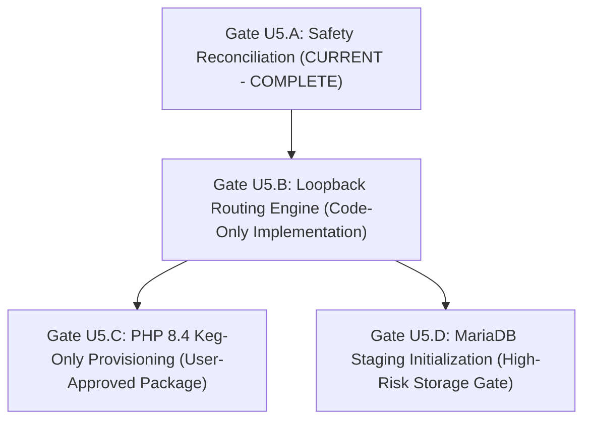

# LocalForge — Gate U5.A Architecture Safety Reconciliation & Implementation Readiness

**Author:** Principal Software Architect, Systems Engineer, Security Engineer & QA Lead  
**Governance:** Product Owner Directive — Gate U5.A  
**Status:** ARCHITECTURE SAFETY RECONCILIATION COMPLETE — IMPLEMENTATION ON HOLD (STRICT NO-GO)  
**Verified Baseline Commit:** `4e2d762a5c3b4bd7437e33fb37a821b64c4c5c3d`  
**GitHub Actions CI Status:** Run `39848607260` — **SUCCESS (100% PASS, Zero Warnings)**  
**Date:** 2026-10-22

---

## 1. Executive Summary & Binding Decisions

Under Product Owner Directive **Gate U5.A**, this document establishes an authoritative, security-hardened reconciliation of the Gate U5 architectural deliverables, provides an honest accounting of preflight verifications versus untested runtime operations, and defines a disciplined, phased implementation proposal across three decoupled work packages (Gates U5.B, U5.C, and U5.D).

### 1.1 The Three Unchanged Binding Decisions
1. **Decision PO-U5-01 (PHP 8.4 Preservation)**:
   - Project `Projetest` (`proj_db5472bb224c4fd0960ff69f793590a7`) MUST remain configured for PHP 8.4 in SQLite (`localforge.db`).
   - No automatic migration to PHP 8.5.
   - No package installation or Homebrew mutation under Gate U5.A.
2. **Decision PO-U5-02 (MariaDB Initialization Hold)**:
   - Host datadir (`~/Library/Application Support/LocalForge/runtime/mariadb`) remains uninitialized (64 bytes empty).
   - No system tables created, no credentials modified, no foreign daemons touched.
   - Dedicated, separate high-risk authorization checkpoint required before any initialization.
3. **Decision PO-U5-03 (Isolated Loopback Routing Direction)**:
   - Project-specific isolated loopback ports (`18081..18999`) remain the confirmed routing direction, completely eliminating `/etc/hosts` and `sudo` requirements.

---

## 2. Security Findings & Corrected Assumptions

### 2.1 MariaDB Runbook Corrections (Task 1)
| Previous Premise | Corrected Security Reality | Concrete Mitigation in Reconciled Runbook |
|---|---|---|
| **Direct Directory Init** | Initializing directly into `runtime/mariadb/data` risks corrupting the target upon partial failure. | Mandated private staging directory `runtime/mariadb/staging_<uuid>` with mode `0700` and proven unprivileged UID ownership. |
| **Filesystem Boundary** | Moving data across volumes is non-atomic and leaves half-copied state. | Staging directory MUST reside on the exact same APFS container filesystem (`/System/Volumes/Data`) to guarantee POSIX atomic `rename()`. |
| **Partial Failure Cleanup** | Blind `rm -rf` cleanup deletes forensic evidence and risks destructive path errors. | Quarantined isolation: Failed staging directories are renamed with `.failed_<timestamp>` suffix for post-mortem analysis. Generic `rm -rf` is prohibited. |
| **Authentication Window** | Standard MariaDB bootstrap creates an unsecured, empty-password `root` window. | Enforced `--auth-root-authentication-method=socket` (Darwin peercred) so root is strictly accessible via local Unix socket by the OS user. No open network window. |
| **Keychain Status** | ADR-0004 specifies macOS Keychain storage, but production crates do not yet implement it. | Explicitly stated that production crates currently use structured in-memory/file configuration; Keychain integration is not claimed as existing until implemented and tested. |
| **Empty Dir vs Auth** | Observing an empty directory on disk was conflated with readiness to write. | Clarified that observing 0 files is purely an empirical physical measurement; authorization to initialize requires explicit human checkpoint. |
| **Database Deletion Lock** | Initializing the database engine could be mistaken for unlocking deletion. | Affirmed that `DatabaseDeletionUnavailable` remains strictly enforced in backend and UI. |

---

### 2.2 Loopback Routing Security Reconciliation (Task 2)
| Previous Premise | Corrected Security Reality | Concrete Mitigation in Reconciled Architecture |
|---|---|---|
| **Complete Isolation Claim** | Separate TCP ports were described as providing full project/browser isolation. | Clarified that loopback ports provide a **routing boundary and Same-Origin Policy (SOP) origin boundary**, but NOT an OS container or complete cookie partition. |
| **RFC 6265 Cookie Sharing** | Standard HTTP cookies ignore TCP ports on `127.0.0.1`. | Enforced per-pool unique session names (`LF_SESS_<project_id>`) and isolated `session.save_path`. Added architectural option for `127.0.0.X` IP alias partitioning. |
| **TOCTOU Port Races** | Probing a port via `TcpListener` does not guarantee it remains free when Nginx binds. | Decoupled SQLite port allocation from OS port ownership. LocalForge handles Nginx `bind()` failures fail-closed, diagnoses foreign PIDs via `lsof`, and offers non-destructive reallocation. |
| **Stopped Project Fallback** | Unmatched ports might accidentally route to default project. | Nginx multi-port configuration ensures stopped or unknown ports return an honest `HTTP 503 / 404` LocalForge maintenance page. Wrong-project routing is strictly prohibited. |
| **PHP Framework Redirects** | Relative redirects (`Location: /path`) could drop non-standard ports. | Configured Nginx `port_in_redirect on;` and `server_name_in_redirect off;` to preserve client connected port in Location headers. |
| **FastCGI Socket Siting** | Storing FastCGI sockets on external APFS storage risks zombie sockets on unmount. | Sockets reside strictly on internal SSD (`Application Support/.../run/`). `VolumeBarrier` fails closed on external volume disconnect without internal disk writes. |

---

### 2.3 PHP 8.4 Installation Plan Hardening (Task 3)
| Previous Premise | Corrected Security Reality | Concrete Mitigation in Reconciled Plan |
|---|---|---|
| **Zero-Collision Guarantee** | Absolute claims of zero collision without empirical proof. | Replaced with **4 testable preconditions** (PATH integrity, sbin symlink absence, opt binary existence, config independence) verified before runtime execution. |
| **Monolithic Workflow** | Installation, discovery, startup, and activation were lumped together. | Partitioned into 4 sequential stages (Provisioning $\rightarrow$ Discovery $\rightarrow$ Pool Startup $\rightarrow$ Project Activation) with distinct failure modes. |
| **Blanket Deletion Rollback** | Rollback suggested `rm -rf /opt/homebrew/etc/php/8.4`. | Replaced with official `brew uninstall php@8.4`; uninstalled configuration files are left to package manager lifecycle without recursive deletion. |
| **Approval Boundaries** | Unclear when user confirmation was required. | Explicitly established that Stage 1 (Homebrew install) requires explicit Product Owner authorization checkpoint. |

---

## 3. Honest Test Classifications (Task 4)

In accordance with Section 1 of the Reconciled Acceptance Matrix:

- **PREFLIGHT VERIFIED (Empirically measured on PO Mac)**:
  - `TEST-U5-01`: Discovered `PHP 8.5.3 (fpm-fcgi arm64)`; verified `8.4` missing.
  - `TEST-U5-02`: Verified SQLite record `Projetest` retains `php_version = "8.4"`.
  - `TEST-U5-05`: Verified datadir is empty (64 bytes), uninitialized, port 3306 free.
- **IMPLEMENTED & TESTED (Code active in repository & passing CI)**:
  - `TEST-U5-03`: Missing PHP warning banner and confirmed version switcher modal in live UI.
  - `TEST-U5-06`: MariaDB supervisor safety guard refusing unapproved datadir initialization.
- **DESIGN REVIEWED (Architectural specs completed, code not yet written)**:
  - `TEST-U5-04`: PHP 8.4 keg-only provisioning plan.
  - `TEST-U5-07`: 12-point staging and atomic promotion runbook.
  - `TEST-U5-08`: Dedicated loopback port allocation architecture.
  - `TEST-U5-09`: Shared Nginx multi-port master isolation template.
  - `TEST-U5-10`: Security threat model covering STRIDE and RFC 6265 cookie scope.
  - `TEST-U5-11`: 4 Direction A+ high-fidelity UX prototypes.
- **NOT RUN / BLOCKED (Requires future implementation approval)**:
  - `TEST-U5-12`: Concurrent live execution of PHP 8.4 and PHP 8.5 projects.
  - `TEST-U5-13`: Framework redirects (WordPress / Laravel) on loopback ports.
  - `TEST-U5-14`: Physical external APFS disconnect under multi-port load.

---

## 4. Implementation Gate Proposal (Task 5)

To ensure maximum safety, zero regressions, and clear verification boundaries, the future implementation work is partitioned into three independently approvable, decoupled work packages.

---

### Work Package U5.B — Loopback Routing Engine
- **Exact Authorized Scope**:
  - Code-only implementation in Rust core and React frontend.
  - SQLite schema migration: Add `loopback_port INTEGER UNIQUE` to `projects` table.
  - Dynamic multi-port configuration generation in `crates/runtime/src/nginx.rs`.
  - Port allocation and TOCTOU conflict resolution in `crates/runtime/src/health.rs`.
  - Frontend "Tarayıcıda Aç" button linking to `http://127.0.0.1:<allocated_port>/`.
  - Automated unit and integration tests using temporary fixture databases and mock sockets.
- **Preconditions**:
  - Baseline commit `4e2d762` intact.
  - Existing `localforge.db` backed up before migration.
- **Prohibited Operations**:
  - NO mutation of existing persistent project metadata without separate authorization.
  - NO package installation.
  - NO MariaDB initialization.
  - NO editing of `/etc/hosts` or system DNS.
- **Test Matrix**:
  - Schema migration integrity test.
  - Multi-port Nginx config generation test.
  - Port collision fail-closed test (foreign PID diagnosis).
  - Relative redirect preservation test (`port_in_redirect on`).
- **Rollback Strategy**:
  - Revert Rust/TS code changes; restore `localforge.db` from pre-migration backup.
- **PO Approval Checkpoint**: `CHECKPOINT PO-U5B-ROUTING`

---

### Work Package U5.C — PHP 8.4 Environment Provisioning
- **Exact Authorized Scope**:
  - Subprocess execution of `brew install php@8.4` (keg-only) following user confirmation.
  - Precondition validation (PATH, sbin, opt binary architecture).
  - `PhpFpmSupervisor` discovery of `/opt/homebrew/opt/php@8.4/sbin/php-fpm`.
  - Spawning and testing `Projetest` FastCGI socket with PHP 8.4.
- **Preconditions**:
  - Gate U5.B loopback routing engine operational.
  - Homebrew environment verified and healthy.
  - Product Owner explicit authorization.
- **Prohibited Operations**:
  - NO `brew link --overwrite` or altering global PHP 8.5.3 CLI.
  - NO automatic migration of `Projetest` to another version.
  - NO recursive deletions (`rm -rf`) in `/opt/homebrew`.
- **Test Matrix**:
  - Precondition validation suite.
  - FastCGI socket connectivity test (`is_unix_socket_alive`).
  - Concurrent PHP 8.4 and PHP 8.5 HTTP request test.
- **Rollback Strategy**:
  - Clean shutdown of PHP 8.4 pool; `brew uninstall php@8.4`; verify PHP 8.5.3 CLI intact.
- **PO Approval Checkpoint**: `CHECKPOINT PO-U5C-PHP84`

---

### Work Package U5.D — MariaDB Staging Initialization
- **Exact Authorized Scope**:
  - Execution of reconciled 12-point initialization runbook.
  - Creation of private staging directory on `/System/Volumes/Data`.
  - `mariadb-install-db` execution with socket peercred authentication.
  - Atomic promotion via same-filesystem rename.
  - Unprivileged `mariadbd` launch and socket readiness probe.
- **Preconditions**:
  - Gate U5.B and U5.C accepted.
  - Verified 1.0 GiB available capacity on internal container.
  - High-risk human approval granted.
- **Prohibited Operations**:
  - NO direct initialization into target directory.
  - NO blind `rm -rf` on failure.
  - NO root privilege or sudo execution.
  - NO database deletion (deletion lock preserved).
- **Test Matrix**:
  - Staging directory permission verification (`0700`).
  - Atomic rename promotion verification.
  - Authenticated SQL ping (`SELECT 1;`) over local Unix domain socket.
  - Failed staging quarantine simulation.
- **Rollback Strategy**:
  - Quarantining of staging directory with `.failed_<timestamp>` suffix; target directory remains untouched.
- **PO Approval Checkpoint**: `CHECKPOINT PO-U5D-MARIADB`

---

## 5. Required Governance & Deliverable Status

1. **Updated Engineering Documents**:
   - `docs/phases/R1_3B_U5_MARIADB_INITIALIZATION_RUNBOOK.md` (Reconciled with staging, socket auth, atomic promotion, no blind cleanup).
   - `docs/phases/R1_3B_U5_LOOPBACK_ROUTING_ARCHITECTURE.md` (Reconciled with 14 technical factors, cookie scoping, SOP boundaries, TOCTOU handling).
   - `docs/phases/R1_3B_U5_SECURITY_THREAT_MODEL.md` (Reconciled with honest residual risks and STRIDE matrix).
   - `docs/phases/R1_3B_U5_RUNTIME_READINESS_REPORT.md` (Reconciled with testable preconditions, 4 stages, and non-destructive rollback).
   - `docs/phases/R1_3B_U5_ACCEPTANCE_MATRIX.md` (Reconciled with 5 explicit statuses and honest untested items list).
2. **Current System State**:
   - Zero production code files modified.
   - Zero packages installed.
   - MariaDB datadir untouched (64 bytes).
   - `Projetest` SQLite record untouched (PHP 8.4).
   - Active branch: `phase-r1/r1-3b-uat-recovery`.
   - Main branch: Untouched.
