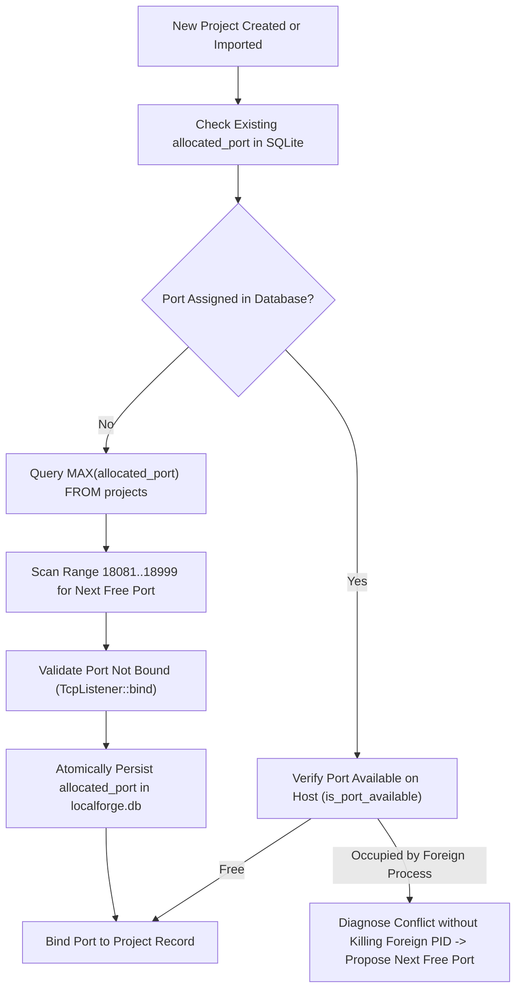
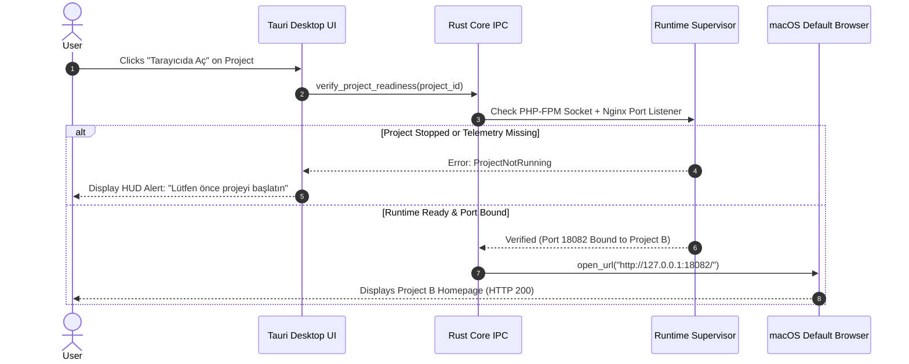

# LocalForge — Gate U5 Isolated Loopback Routing Architecture
## Dedicated Port Allocation, Multi-Port Nginx Gateway & Browser Compatibility Specification

**Author:** Principal Software Architect & Systems Engineer  
**Governance:** Gate U5 — Runtime Readiness & Isolated Loopback Routing Architecture  
**Status:** ARCHITECTURAL DESIGN COMPLETED — IMPLEMENTATION ON HOLD  
**Binding Decision:** `PO-U5-03` (Isolated Loopback Routing)  
**Date:** 2026-10-22

---

## 1. Architectural Objective & Core Problem Statement

### 1.1 The User Experience Goal
The primary objective defined by the Product Owner in **Decision PO-U5-03** is:

$$\text{Select Project} \longrightarrow \text{Start Project} \longrightarrow \text{Open in Browser} \longrightarrow \text{Correct Project Opens Immediately}$$

The local development studio must provide an out-of-the-box browser experience that **never requires**:
- Manual terminal intervention (`sudo vi /etc/hosts`).
- Modifying system-wide DNS configurations (`/etc/resolver/test`).
- Third-party DNS proxy daemons (`dnsmasq`, `Acrylic`, etc.).
- Elevating LocalForge processes to `root`.

### 1.2 The Root Cause of `.test` Domain Failure
In Phase R1.1 through R1.3B, LocalForge routed all projects through a single shared Nginx port (`127.0.0.1:8080`), multiplexing virtual hosts based on the HTTP `Host:` header (e.g., `Host: projetest.test`).
- While this works seamlessly for programmatic HTTP clients (`curl -H "Host: projetest.test" http://127.0.0.1:8080/`), standard macOS browsers (Safari, Chrome, Arc) rely on the operating system's `mDNSResponder` resolver.
- RFC 6761 reserves `.test` for testing, but **does not specify** automatic resolution to `127.0.0.1`.
- Consequently, typing `http://projetest.test:8080/` in a browser triggers an immediate `NXDOMAIN` (Name Not Resolved) DNS failure.

### 1.3 The Solution: Deterministic Isolated Loopback Ports
By allocating each project an isolated loopback port on `127.0.0.1` (e.g. `127.0.0.1:18081`, `127.0.0.1:18082`), the endpoint is resolved directly by the IP protocol stack with **zero DNS lookup**:
- Project A (`r1_acceptance_project`) $\longrightarrow$ `http://127.0.0.1:18081/`
- Project B (`Projetest`) $\longrightarrow$ `http://127.0.0.1:18082/`
- Every browser, mobile simulator, terminal, and API client can connect instantly and reliably.

---

## 2. Gateway Architecture Trade-Off Analysis (Option A vs Option B)

To route multiple distinct ports to their respective project document roots and FastCGI sockets, two architectural options were evaluated:

| Architectural Metric | Option A: Shared Multi-Port Nginx Master | Option B: Per-Project Dedicated Nginx Daemons | Evaluation Winner |
|---|---|---|---|
| **Memory Footprint** | ~6–10 MB total for 1 master + 1 worker across 50 ports | ~10 MB *per running project* (100 MB for 10 projects) | **Option A** (Vastly more efficient) |
| **Process Lifecycle** | 1 supervisor (`NginxSupervisor`) managing single PID | N supervisors managing N PIDs, PID files, and sockets | **Option A** (Minimal complexity) |
| **Port Collision Defense** | Centrally verified before rewriting master `nginx.conf` | Decentralized startup races across independent processes | **Option A** (Fail-closed central registry) |
| **Configuration Reload** | Atomic `nginx -s reload` (zero downtime) | Spawning / terminating separate daemons | **Option A** (Instantaneous) |
| **ProcessIdentity Safety** | Reuses existing battle-tested Darwin kernel PID check | Must verify and register N independent process trees | **Option A** |
| **Tenant Isolation** | Physical port separation; port X maps strictly to Project X | Full process isolation | **Tie** (Both physically isolate traffic) |

### 2.1 Authoritative Recommendation: **Option A (Shared Multi-Port Nginx Master)**
LocalForge will retain its centralized, unprivileged `NginxSupervisor`. Each project will receive a dedicated `server { listen 127.0.0.1:<allocated_port>; ... }` block inside the managed `nginx.conf`. This guarantees:
1. Zero cross-tenant leakage: Even if a client sends an arbitrary or spoofed `Host` header on port `18082`, Nginx serves **only** Project B's root directory and FastCGI pool.
2. Lightweight execution: Event-driven epoll/kqueue handles dozens of loopback ports with negligible CPU and RAM overhead.

---

## 3. Port Allocation Contract & Strategy



### 3.1 Allocation Specifications
1. **Dedicated Port Range**: `18081` to `18999` (Unprivileged user space > 1024, distinct from macOS ephemeral ports > 49152).
2. **Persistence Guarantee**: Once assigned, a project's `allocated_port` is permanently stored in SQLite and remains identical across application restarts and macOS reboots.
3. **Collision Detection Without Process Killing**:
   - Before binding or launching Nginx, LocalForge probes the port via `is_port_available(port)`.
   - If an unrelated process owns the port, LocalForge reports `PORT ÇAKIŞMASI` with foreign PID diagnostics and **never attempts to kill foreign processes**.
4. **Backward Compatibility**:
   - The existing `local_domain` column (e.g. `projetest.test`) is preserved intact in SQLite and YAML manifests.
   - Nginx server blocks will listen on both the dedicated port AND declare `server_name <local_domain> localhost 127.0.0.1`, preserving future compatibility with custom DNS or hosts setups.

---

## 4. Nginx Server Block & FastCGI Isolation Template

The generated `nginx.conf` (`crates/runtime/src/nginx.rs`) will implement the following isolation pattern:

```nginx
# ==============================================================================
# LOCALFORGE GATEWAY — ISOLATED LOOPBACK MULTI-PORT CONFIGURATION
# ==============================================================================
worker_processes 1;
daemon off;
pid /Users/mehmetakar/Library/Application Support/LocalForge/runtime/nginx/nginx.pid;
error_log /Users/mehmetakar/Library/Application Support/LocalForge/runtime/nginx/error.log warn;

events {
    worker_connections 256;
}

http {
    include /opt/homebrew/etc/nginx/mime.types;
    default_type application/octet-stream;
    access_log off;
    sendfile on;
    keepalive_timeout 65;

    # --------------------------------------------------------------------------
    # DEFAULT SERVER (Port 8080) — Fail-closed loopback trap
    # Blocks cross-tenant leakage on unqualified requests
    # --------------------------------------------------------------------------
    server {
        listen 127.0.0.1:8080 default_server;
        server_name _;
        return 404 "LocalForge Gateway: Unrecognized host or endpoint.\n";
    }

    # --------------------------------------------------------------------------
    # PROJECT A: r1_acceptance_project (PHP 8.5)
    # --------------------------------------------------------------------------
    server {
        listen 127.0.0.1:18081;
        server_name r1_acceptance_project.test localhost 127.0.0.1;
        root "/Volumes/Mac Harici Disk/VibeProject/LocalForge/scratch/r1_acceptance_project/public";
        index index.php index.html;

        location / {
            try_files $uri $uri/ /index.php?$query_string;
        }

        location ~ \.php$ {
            fastcgi_pass unix:/Users/mehmetakar/Library/Application Support/LocalForge/runtime/run/proj_e92e56cd0e0c4c36952804a35b3587a3.sock;
            fastcgi_index index.php;
            include /opt/homebrew/etc/nginx/fastcgi_params;
            fastcgi_param SCRIPT_FILENAME $document_root$fastcgi_script_name;
            fastcgi_param SERVER_PORT 18081;
        }
    }

    # --------------------------------------------------------------------------
    # PROJECT B: Projetest (PHP 8.4)
    # --------------------------------------------------------------------------
    server {
        listen 127.0.0.1:18082;
        server_name projetest.test localhost 127.0.0.1;
        root "/Volumes/Mac Harici Disk/VibeProject/LocalForge/Projetest/public";
        index index.php index.html;

        location / {
            try_files $uri $uri/ /index.php?$query_string;
        }

        location ~ \.php$ {
            fastcgi_pass unix:/Users/mehmetakar/Library/Application Support/LocalForge/runtime/run/proj_db5472bb224c4fd0960ff69f793590a7.sock;
            fastcgi_index index.php;
            include /opt/homebrew/etc/nginx/fastcgi_params;
            fastcgi_param SCRIPT_FILENAME $document_root$fastcgi_script_name;
            fastcgi_param SERVER_PORT 18082;
        }
    }
}
```

---

## 5. Browser Compatibility Analysis & Mitigation Matrix

Accessing web applications via explicit loopback ports (`http://127.0.0.1:18082/`) has distinct behavioral characteristics that developers and frameworks must account for:

| Web Subsystem | Behavioral Consideration | Framework Impact | LocalForge Architectural Solution |
|---|---|---|---|
| **Absolute Redirects** | Applications calling `header("Location: /path")` work transparently. Calls embedding `SERVER_NAME` without port may break. | WordPress, Drupal | Nginx explicitly forwards `fastcgi_param SERVER_PORT $server_port;` and `fastcgi_param HTTP_HOST $http_host;` preserving port in redirect headers. |
| **WordPress Site URL** | WordPress hardcodes `siteurl` and `home` options in `wp_options`. | `wp-config.php` | LocalForge provides an actionable inspector helper: `define('WP_HOME', 'http://127.0.0.1:18082');` and `define('WP_SITEURL', 'http://127.0.0.1:18082');`. |
| **Laravel `APP_URL`** | Laravel builds asset links using `.env` `APP_URL`. | Laravel / Symfony | Set `APP_URL=http://127.0.0.1:18082` in project `.env`. |
| **Cookie Port Scoping** | Standard browser cookies (`Set-Cookie`) scope to IP/domain, NOT to port numbers. | Multi-project session sharing | Cookies set by Project A on `127.0.0.1` may be sent to Project B on `127.0.0.1` if cookie names collide (e.g. `PHPSESSID`). LocalForge FastCGI pool configuration isolates session storage paths (`php_value[session.save_path]`) and can configure custom session cookie names per pool. |
| **CORS & Origin** | Origin header includes port: `http://127.0.0.1:18081` is treated as cross-origin from `http://127.0.0.1:18082`. | SPA frontends | Proper Same-Origin Policy boundary enforced by browser automatically. |
| **Local WebSockets** | Connects directly to `ws://127.0.0.1:18082/...`. | Vite, Livewire | Works without proxy reconfiguration. |

---

## 6. Tauri UX Contract — "Open in Browser" Workflow

The desktop application (`apps/desktop/src/App.tsx`) will enforce a strict, 6-step verified preflight before launching any browser window:



---

## 7. Proposed Data-Contract Changes (For Future Implementation)

### 7.1 SQLite Schema Migration Diff (`crates/storage/src/db.rs`)

```sql
-- Migration: Add allocated_port column to projects table
ALTER TABLE projects ADD COLUMN allocated_port INTEGER UNIQUE;

-- Create index for instant port lookup
CREATE UNIQUE INDEX IF NOT EXISTS idx_projects_allocated_port ON projects(allocated_port);
```

### 7.2 Rust Domain Model Diff (`crates/core/src/project.rs`)

```rust
#[derive(Debug, Clone, Serialize, Deserialize)]
pub struct ProjectRecord {
    pub id: ProjectId,
    pub name: String,
    pub path: PathBuf,
    pub volume_uuid: VolumeId,
    pub document_root: String,
    pub php_version: String,
    pub local_domain: String,
    pub allocated_port: Option<u16>, // NEW: Isolated loopback port
    pub status: ProjectStatus,
    pub created_at: String,
    pub updated_at: String,
}
```

### 7.3 TypeScript Interface Diff (`apps/desktop/src/types.ts`)

```typescript
export interface ProjectRecord {
  id: string;
  name: string;
  path: string;
  volume_uuid: string;
  document_root: string;
  php_version: string;
  local_domain: string;
  allocated_port?: number | null; // NEW: Isolated loopback port
  status: ProjectStatus;
  created_at: string;
  updated_at: string;
}
```

---

## 8. Architectural Summary & Gate Status
- **Architecture Selected**: Option A (Shared Multi-Port Nginx Master).
- **Port Strategy**: Dedicated range `18081–18999`, persistent in SQLite, collision-checked.
- **Implementation Status**: **STRICT HOLD — NO CODE MODIFIED IN GATE U5**.
