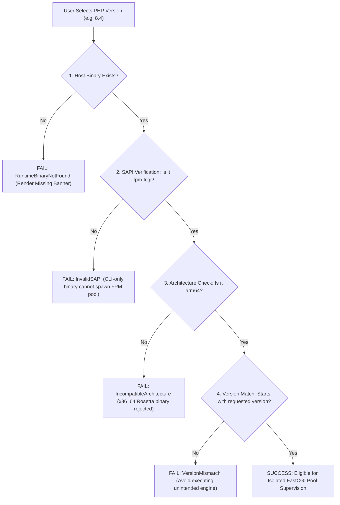
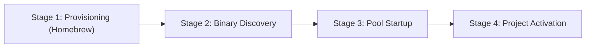

# LocalForge — Gate U5 Runtime Readiness Report
## Read-Only Environment Audit, Version Distinction & PHP 8.4 Provisioning Plan (Reconciled)

**Author:** Principal Software Architect & Systems Engineer  
**Governance:** Gate U5.A — Architecture Safety Reconciliation & Implementation Readiness  
**Status:** READ-ONLY PREFLIGHT COMPLETED — IMPLEMENTATION ON HOLD (STRICT NO-GO)  
**Binding Decisions:** `PO-U5-01` (PHP 8.4 Preservation), `PO-U5-02` (MariaDB Initialization Hold), `PO-U5-03` (Isolated Loopback Routing)  
**Date:** 2026-10-22

---

## 1. Executive Summary & Governance Guardrails

Under Product Owner Directive **Gate U5.A**, this report delivers an authoritative, evidence-based preflight inventory of the host environment runtimes, evaluates the feasibility and safety of side-by-side PHP-FPM co-existence, and specifies an approval-gated provisioning plan for PHP 8.4.

### 1.1 Non-Negotiable Governance Invariants
1. **Decision PO-U5-01 (PHP 8.4 Preservation)**:
   - Project `Projetest` (`proj_db5472bb224c4fd0960ff69f793590a7`) MUST remain configured for PHP 8.4 in `localforge.db`.
   - **Zero automated migrations**: Neither the backend, desktop UI, nor CLI may silently upgrade `Projetest` to PHP 8.5.
   - **Zero system modification in Gate U5.A**: No Homebrew packages are installed, upgraded, linked, or altered.
2. **Read-Only Preflight**:
   - All diagnostic data herein was collected strictly via non-mutating system calls and filesystem inspections.
   - All proposed provisioning actions are subject to subsequent, separate Product Owner approval under **Gate U5.C**.

---

## 2. Read-Only Environment Inventory

The host system was inspected on **2026-10-22 at 23:08:18+03:00** with the following concrete telemetry:

| Property | Measured Value | Verification Evidence |
|---|---|---|
| **Operating System** | macOS 27.0 (Build 26A428) | `sw_vers` exit 0 |
| **Darwin Kernel** | Darwin Kernel Version 27.0.0 | `uname -a` (Tue Aug 11 21:05:27 PDT 2026) |
| **Hardware Architecture** | Apple Silicon M1 (`arm64`) | `uname -m` -> `arm64` |
| **Homebrew Prefix** | `/opt/homebrew` | Standard Apple Silicon Homebrew installation |
| **Installed Homebrew PHP** | `php 8.5.3` (Linked) | `brew list --versions php` -> `php 8.5.3` |
| **PHP CLI Binary Path** | `/opt/homebrew/bin/php` | Symlink to `../Cellar/php/8.5.3/bin/php` |
| **PHP-FPM Binary Path** | `/opt/homebrew/sbin/php-fpm` | Symlink to `../Cellar/php/8.5.3/sbin/php-fpm` |
| **Binary Mach-O Format** | `Mach-O 64-bit executable arm64` | `file /opt/homebrew/bin/php /opt/homebrew/sbin/php-fpm` |
| **PHP-FPM SAPI Check** | `PHP 8.5.3 (fpm-fcgi) (built: Feb 10 2026 18:25:51) (NTS)` | `/opt/homebrew/sbin/php-fpm -v` |
| **Standard PATH php-fpm** | `not found` in `/usr/bin`, `/bin`, `/usr/sbin` | `which -a php-fpm` fails because `/opt/homebrew/sbin` is daemon-isolated |
| **Active LocalForge Projects** | 2 persistent projects in SQLite (`localforge.db`) | Inspected via `sqlite3` query on `projects` table |

### 2.1 Project Metadata Breakdown

```sql
SELECT id, name, php_version, status, path, local_domain FROM projects;
```

| Project ID | Name | Target PHP Version | Registered Status | Storage Location | Local Domain |
|---|---|---|---|---|---|
| `proj_e92e56cd0e0c4c36952804a35b3587a3` | `r1_acceptance_project` | **8.5** | `running` | `/Volumes/Mac Harici Disk/.../scratch/r1_acceptance_project` | `r1_acceptance_project.test` |
| `proj_db5472bb224c4fd0960ff69f793590a7` | `Projetest` | **8.4** | `stopped` / `failed` | `/Volumes/Mac Harici Disk/VibeProject/LocalForge/Projetest` | `projetest.test` |

---

## 3. Dissecting Runtime Availability: CLI vs FPM vs Architecture

LocalForge enforces a multi-tier runtime verification contract:



---

## 4. Reconciled PHP 8.4 Provisioning Plan (Subject to Gate U5.C Approval)

To satisfy `Projetest`'s requirement for PHP 8.4 without altering or degrading the existing PHP 8.5 installation, the following hardened plan has been formulated.

### 4.1 Homebrew Keg-Only Architecture & Formula Assumptions
- **Target Formula**: `php@8.4` (bottled, Apple Silicon `arm64`).
- **Packaging Mode**: **`keg-only`**. Homebrew defines `keg-only` formulas as packages installed strictly into their isolated Cellar prefix and NOT symlinked into `/opt/homebrew/bin` or `/opt/homebrew/sbin`.
- **Target Paths**:
  - Cellar: `/opt/homebrew/Cellar/php@8.4/<version>/`
  - Opt Link: `/opt/homebrew/opt/php@8.4/`
  - FPM Executable: `/opt/homebrew/opt/php@8.4/sbin/php-fpm`
  - Configuration: `/opt/homebrew/etc/php/8.4/`
- **Dependency Assumptions**: `php@8.4` shares common libraries (`openssl@3`, `icu4c`, `libpng`, `pcre2`). Homebrew manages shared dylibs safely via `@rpath` Mach-O linkages.

### 4.2 Testable Preconditions (Replacing Absolute Guarantees)
Rather than asserting an untested "zero-collision guarantee", LocalForge defines **four verifiable preconditions** that must be tested prior to project execution:
1. **Precondition 1 (PATH Integrity)**: `/opt/homebrew/bin/php -v` must return `PHP 8.5.x` before and after installation.
2. **Precondition 2 (Sbin Symlink Absence)**: `/opt/homebrew/sbin/php-fpm` must remain linked to `../Cellar/php/8.5.3/...` and never point to `php@8.4`.
3. **Precondition 3 (Opt Existence)**: `/opt/homebrew/opt/php@8.4/sbin/php-fpm` must exist and be an independent `arm64` executable.
4. **Precondition 4 (Independent Config)**: `/opt/homebrew/etc/php/8.4/php-fpm.conf` must not conflict with `/opt/homebrew/etc/php/8.5/`.

If any precondition fails, LocalForge treats the installation as unverified and blocks FPM startup.

---

## 5. Four Distinct Lifecycle Stages & Failure Handling

The provisioning of PHP 8.4 is partitioned into four distinct, sequential stages. Each stage has its own failure handling and approval boundary:



### Stage 1: Environment Provisioning (Requires PO Approval Checkpoint)
- **Action**: Execute `brew install php@8.4` strictly without `brew link --overwrite`.
- **Failure Modes & Handling**:
  - *Network timeout / bottle missing*: Report Homebrew error code; abort without mutating filesystem.
  - *Dependency conflict*: Halt provisioning; retain existing PHP 8.5 without modification.
- **PO Checkpoint**: Requires explicit user authorization in the UI or CLI before launching Homebrew subprocess.

### Stage 2: Binary Discovery & Architecture Verification (Automatic Read-Only)
- **Action**: `PhpFpmSupervisor` scans `/opt/homebrew/opt/php@8.4/sbin/php-fpm`.
- **Failure Modes & Handling**:
  - *Binary not found*: Retain `RuntimeBinaryNotFound` status in UI; `Projetest` cannot be started.
  - *Non-arm64 binary (Rosetta)*: Emit `IncompatibleArchitecture`; refuse execution.
  - *CLI-only binary*: Emit `InvalidSAPI`; refuse execution.

### Stage 3: Dedicated FastCGI Pool Startup (On Project Start)
- **Action**: Spawn dedicated PHP 8.4 master process pointing to `~/.localforge/run/proj_db5472bb224c4fd0960ff69f793590a7.sock`.
- **Failure Modes & Handling**:
  - *Port/Socket conflict*: Fail closed, clean up temporary pool configuration, emit diagnostic error.
  - *Configuration syntax error*: Validate pool configuration with `php-fpm -t` before spawning.

### Stage 4: Project Activation & Routing Binding (On Successful Socket Ping)
- **Action**: Once the socket responds (`is_unix_socket_alive`), Nginx configuration reloads to route requests to the active socket.
- **Failure Modes & Handling**:
  - *Socket unresponsive after 15s timeout*: Kill child process group cleanly (`bounded_sigterm_tree`), mark project `failed`, revert Nginx configuration.

---

## 6. Non-Destructive Rollback Strategy (No Blind `rm -rf`)

If removal of PHP 8.4 is requested by the Product Owner:
1. Stop any active PHP 8.4 project pools cleanly via `PhpFpmSupervisor::stop()`.
2. Verify no active FastCGI sockets remain in `~/.localforge/run/`.
3. Run official package manager uninstallation:
   ```bash
   brew uninstall php@8.4
   ```
4. **No Blanket Deletion**: Never run blind recursive deletions (`rm -rf /opt/homebrew/etc/php/...`). Uninstalled configuration files in `/opt/homebrew/etc/` are harmless text files left to Homebrew's own standard package lifecycle.
5. Verify `/opt/homebrew/bin/php -v` continues to report `PHP 8.5.3`.

---

## 7. Preflight Conclusion & Status

- **Host Inspection**: COMPLETED (Read-only).
- **Projetest Record**: **Preserved at PHP 8.4**.
- **Execution of Provisioning**: **HOLD** (Awaiting explicit Gate U5.C Product Owner authorization).
