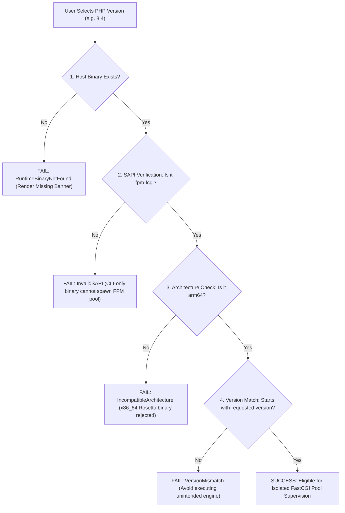

# LocalForge — Gate U5 Runtime Readiness Report
## Read-Only Environment Audit, Version Distinction & PHP 8.4 Provisioning Plan

**Author:** Principal Software Architect & Systems Engineer  
**Governance:** Gate U5 — Runtime Readiness & Isolated Loopback Routing Architecture  
**Status:** READ-ONLY PREFLIGHT COMPLETED — IMPLEMENTATION ON HOLD  
**Binding Decisions:** `PO-U5-01` (PHP 8.4 Preservation), `PO-U5-02` (MariaDB Initialization Hold), `PO-U5-03` (Isolated Loopback Routing)  
**Date:** 2026-10-22

---

## 1. Executive Summary & Governance Guardrails

Under Product Owner Directive **Gate U5**, this report delivers an authoritative, evidence-based preflight inventory of the host environment runtimes, evaluates the feasibility and safety of side-by-side PHP-FPM co-existence, and specifies an approval-gated provisioning plan for PHP 8.4.

### 1.1 Non-Negotiable Governance Invariants
1. **Decision PO-U5-01 (PHP 8.4 Preservation)**:
   - Project `Projetest` (`proj_db5472bb224c4fd0960ff69f793590a7`) MUST remain configured for PHP 8.4 in `localforge.db`.
   - **Zero automated migrations**: Neither the backend, desktop UI, nor CLI may silently upgrade `Projetest` to PHP 8.5.
   - **Zero system modification in Gate U5**: No Homebrew packages are installed, upgraded, linked, or altered during this gate.
2. **Read-Only Preflight**:
   - All diagnostic data herein was collected strictly via non-mutating system calls and filesystem inspections.
   - All proposed installation actions are subject to subsequent, separate Product Owner approval.

---

## 2. Read-Only Environment Inventory

The host system was inspected on **2026-10-22 at 23:08:18+03:00** with the following concrete telemetry:

| Property | Measured Value | Verification Evidence |
|---|---|---|
| **Operating System** | macOS 27.0 (Build 26A428) | `sw_vers` exit 0 |
| **Darwin Kernel** | Darwin Kernel Version 27.0.0 | `uname -a` (Tue Aug 11 21:05:27 PDT 2026) |
| **Hardware Architecture** | Apple Silicon M1 (`arm64`) | `uname -m` -> `arm64` |
| **Homebrew Prefix** | `/opt/homebrew` | Standard Apple Silicon Homebrew installation |
| **Installed Homebrew PHP** | `php 8.5.3` (Linked) | `brew list --versions php` -> `php 8.5.3` |
| **PHP CLI Binary Path** | `/opt/homebrew/bin/php` | Symlink to `../Cellar/php/8.5.3/bin/php` |
| **PHP-FPM Binary Path** | `/opt/homebrew/sbin/php-fpm` | Symlink to `../Cellar/php/8.5.3/sbin/php-fpm` |
| **Binary Mach-O Format** | `Mach-O 64-bit executable arm64` | `file /opt/homebrew/bin/php /opt/homebrew/sbin/php-fpm` |
| **PHP-FPM SAPI Check** | `PHP 8.5.3 (fpm-fcgi) (built: Feb 10 2026 18:25:51) (NTS)` | `/opt/homebrew/sbin/php-fpm -v` |
| **Standard PATH php-fpm** | `not found` in `/usr/bin`, `/bin`, `/usr/sbin` | `which -a php-fpm` fails because `/opt/homebrew/sbin` is daemon-isolated |
| **Active LocalForge Projects** | 2 persistent projects in SQLite (`localforge.db`) | Inspected via `sqlite3` query on `projects` table |

### 2.1 Project Metadata Breakdown

```sql
SELECT id, name, php_version, status, path, local_domain FROM projects;
```

| Project ID | Name | Target PHP Version | Registered Status | Storage Location | Local Domain |
|---|---|---|---|---|---|
| `proj_e92e56cd0e0c4c36952804a35b3587a3` | `r1_acceptance_project` | **8.5** | `running` | `/Volumes/Mac Harici Disk/.../scratch/r1_acceptance_project` | `r1_acceptance_project.test` |
| `proj_db5472bb224c4fd0960ff69f793590a7` | `Projetest` | **8.4** | `stopped` / `failed` | `/Volumes/Mac Harici Disk/VibeProject/LocalForge/Projetest` | `projetest.test` |

---

## 3. Dissecting Runtime Availability: CLI vs FPM vs Architecture

A common pitfall in local development tools is assuming that if `php -v` succeeds in the terminal, PHP is fully functional for web development. LocalForge strictly enforces a multi-tier runtime verification contract:



### 3.1 Five-Tier Classification Matrix

1. **PHP CLI Availability**: Verifies whether `php` exists to run console commands, Composer scripts, or artisan commands.
2. **PHP-FPM Binary Availability**: Verifies whether the dedicated FastCGI daemon executable (`php-fpm`) exists on disk.
3. **Architecture Integrity**: Verifies whether the binary was compiled natively for `arm64`. LocalForge tier-1 policy rejects mixed Rosetta 2 emulation processes in production pipelines.
4. **Requested Version Compatibility**: Verifies whether the discovered binary satisfies the project's exact declared version (`8.4.x` for `Projetest`, `8.5.x` for `r1_acceptance_project`).
5. **Runtime Process Health**: Verifies whether the spawned master/worker pool is responsive on its assigned Unix domain socket (`is_unix_socket_alive`).

---

## 4. PHP 8.4 Provisioning Plan (Subject to PO Approval)

To satisfy `Projetest`'s requirement for PHP 8.4 without altering or degrading the existing PHP 8.5 installation, the following safe provisioning plan has been formulated.

### 4.1 Homebrew Keg-Only Architecture
Homebrew provides official versioned formulas for PHP. An inspection of `brew info php@8.4` confirms:
- **Formula Name**: `php@8.4`
- **Current Version**: `8.4.26 (bottled)`
- **Packaging Strategy**: **`keg-only`**. Homebrew defines `keg-only` formulas as packages that are deliberately installed into their isolated Cellar prefix and NOT symlinked into `/opt/homebrew/bin` or `/opt/homebrew/sbin`.
- **Target Installation Prefix**:
  - Cellar: `/opt/homebrew/Cellar/php@8.4/8.4.26/`
  - Opt Link: `/opt/homebrew/opt/php@8.4/`
  - FPM Executable: `/opt/homebrew/opt/php@8.4/sbin/php-fpm`
  - Configuration Dir: `/opt/homebrew/etc/php/8.4/`

### 4.2 Zero-Collision Guarantee
Because `php@8.4` is keg-only:
1. `/opt/homebrew/bin/php` remains pointing to `../Cellar/php/8.5.3/bin/php` (100% untouched).
2. `/opt/homebrew/sbin/php-fpm` remains pointing to `../Cellar/php/8.5.3/sbin/php-fpm` (100% untouched).
3. No environment variables in the user's `.zshrc` or global shell PATH are altered.
4. Neither formula executes automatic service daemons unless `brew services` is explicitly invoked.

### 4.3 Proposed Implementation Workflow (For Future Authorized Execution)

```bash
# STEP 1: Pre-installation check (Ensure Homebrew bottle is available)
brew info php@8.4

# STEP 2: Non-destructive installation (Explicitly avoid linking)
brew install php@8.4

# STEP 3: Verify binary integrity and architecture
file /opt/homebrew/opt/php@8.4/sbin/php-fpm
/opt/homebrew/opt/php@8.4/sbin/php-fpm -v

# STEP 4: Confirm keg-only status (Ensure global php remains 8.5.3)
/opt/homebrew/bin/php -v
# Expected: PHP 8.5.3

# STEP 5: LocalForge Telemetry Rescan
# LocalForge's PhpFpmSupervisor automatically discovers /opt/homebrew/opt/php@8.4/sbin/php-fpm
# and marks PHP 8.4 as (Kurulu · FPM arm64).
```

### 4.4 Rollback Procedure
If the Product Owner ever orders removal:
```bash
brew uninstall php@8.4
rm -rf /opt/homebrew/etc/php/8.4
# System returns precisely to its current preflight state.
```

---

## 5. LocalForge Version-Specific FastCGI Supervisor Contract

LocalForge does **NOT** rely on system-wide daemons or global symlinks. Each project is managed by `PhpFpmSupervisor` (`crates/runtime/src/php.rs`) using dynamic candidate resolution:

```rust
// Candidate discovery order in crates/runtime/src/php.rs
let candidates = vec![
    format!("/opt/homebrew/opt/php@{requested_version}/sbin/php-fpm"), // Specific version keg-only
    "/opt/homebrew/opt/php/sbin/php-fpm".to_string(),                 // Default keg opt
    "/opt/homebrew/sbin/php-fpm".to_string(),                         // Default sbin
    "/opt/homebrew/bin/php-fpm".to_string(),                          // Fallback bin
    format!("/usr/local/opt/php@{requested_version}/sbin/php-fpm"),   // Intel Mac keg
    "/usr/local/sbin/php-fpm".to_string(),
    "/usr/local/bin/php-fpm".to_string(),
];
```

### 5.1 Per-Project FastCGI Pool Isolation
When `Projetest` (PHP 8.4) and `r1_acceptance_project` (PHP 8.5) run concurrently:
- `r1_acceptance_project`: Spawns master process using `/opt/homebrew/sbin/php-fpm` (8.5.3), bound to Unix socket `/Users/mehmetakar/Library/Application Support/LocalForge/runtime/run/proj_e92e56cd0e0c4c36952804a35b3587a3.sock`.
- `Projetest`: Spawns master process using `/opt/homebrew/opt/php@8.4/sbin/php-fpm` (8.4.26), bound to Unix socket `/Users/mehmetakar/Library/Application Support/LocalForge/runtime/run/proj_db5472bb224c4fd0960ff69f793590a7.sock`.
- **Zero cross-talk**: Neither pool shares configuration files, processes, worker pools, or sockets.
- **Fail-Closed Monitoring**: If an FPM master crashes or socket is removed, LocalForge immediately transitions status to `stopped` or `degraded`.

---

## 6. Preflight Conclusion & Status
- **Current Status**: Preflight inventory completed.
- **Projetest Record**: **Preserved at PHP 8.4**.
- **Installation Execution**: **HOLD** (Awaiting explicit Product Owner execution approval).
